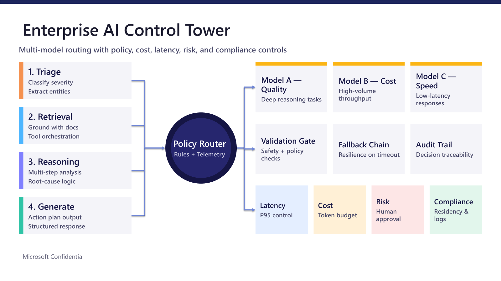

# Architecture

## Overview

The system implements an **Enterprise AI Control Tower** for policy-routed, multi-model orchestration.  
It routes each request to the best model profile (**Quality**, **Cost**, or **Speed**) while enforcing safety, compliance, latency, and audit controls.

## End-to-end flow

1. **Triage**
   - Detect intent, severity, entities, and risk flags.
   - Produces `TriageResult`.

2. **Retrieval**
   - Adds grounding snippets from available knowledge/context.
   - Produces `RetrievalResult`.

3. **Reasoning**
   - Builds a structured execution plan.
   - Produces `ReasoningPlan`.

4. **Policy Router**
   - Selects route (`quality`, `cost`, `speed`) based on:
     - compliance mode
     - risk flags
     - severity
     - latency budget
     - cost tier
   - Produces `RouteDecision`.

5. **Validation Gate (pre-check)**
   - Blocks unsafe, empty, or policy-violating input.

6. **Model execution + Fallback chain**
   - Executes primary route model.
   - On failure, follows deterministic fallback order.

7. **Generation**
   - Produces report output.
   - For structured briefs, emits:
     - Multi-Stage LLM Strategy Recommendation
     - Executive Decision
     - Stage-wise Model Routing
     - Top-3 Portfolio Comparison
     - Enterprise Readiness
     - Assumptions and Sources

8. **Validation Gate (post-check)**
   - Ensures output is non-empty and valid.

9. **Audit + Telemetry**
   - Writes route, triage summary, and runtime metrics to JSONL audit log.
   - CLI also persists final report output to `output\name_compliance_date.md`.

## Module map

- `llm_advisor/engine.py`  
  Orchestrates all stages and returns `AdvisorResult`.

- `llm_advisor/triage.py`  
  Intent/severity/entity/risk classification.

- `llm_advisor/retrieval.py`  
  Grounding layer.

- `llm_advisor/reasoning.py`  
  Structured reasoning plan builder.

- `llm_advisor/router.py`  
  Policy-based route selection logic.

- `llm_advisor/validator.py`  
  Pre/post validation checks.

- `llm_advisor/fallback.py`  
  Deterministic fallback route sequencing.

- `llm_advisor/models.py`  
  Model adapter abstraction and backends:
  - mock backend (default)
  - OpenAI-compatible backend (optional)

- `llm_advisor/generation.py`  
  Final response formatter.

- `llm_advisor/telemetry.py`  
  Request metrics structure.

- `llm_advisor/audit.py`  
  JSONL audit writer.

- `llm_advisor/cli.py`  
  Command-line interface and output file saver.

## Routing policy (current defaults)

- **Quality route** when:
  - compliance is `strict`, or
  - request has compliance-sensitive risk flags, or
  - severity is high.

- **Speed route** when latency budget is below threshold.

- **Cost route** when cost tier is low and no stricter policy applies.

- Fallback defaults:
  - `quality -> cost -> speed`
  - `cost -> speed -> quality`
  - `speed -> cost -> quality`

## Governance controls

- **Safety/Policy**: destructive or abusive prompts are blocked.
- **Compliance-first override**: compliance and risk supersede cost/latency preferences.
- **Traceability**: each run emits an audit record with `audit_id`.
- **Resilience**: fallback chain handles model outages/timeouts.

## Extensibility

1. Add provider adapters in `models.py` behind the `ModelAdapter` interface.
2. Replace rule-based routing with scored routing while preserving `RouteDecision`.
3. Integrate enterprise retrieval connectors in `retrieval.py`.
4. Add human-approval gates for specific risk classes.
5. Expand telemetry to include p95 latency and token/cost budgets per tenant.
